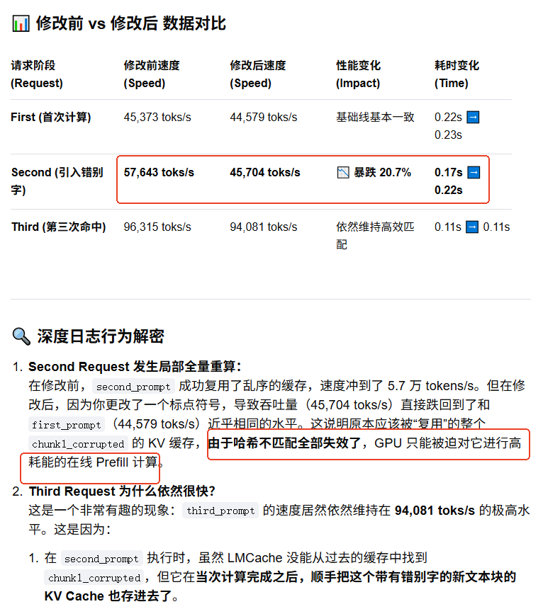

[benchmarking/setup/patch_vllm_for_lmcache_cacheblend.py](https://github.com/RaviTejGuntuku/kv_cache_optimization/blob/daff2c492dfc3c34c263671ba0f442e3f18baeea/benchmarking/setup/patch_vllm_for_lmcache_cacheblend.py)    

[demo-rag-blending](https://github.com/LMCache/LMCache-Examples/tree/19b31ac24b37bbbd260cb701d07a916d4b1f7ed8/demo-rag-blending)      

[LMCache/benchmarks/rag](https://github.com/Celeste025/pic_project/tree/d2c151dbe86bc308fce75d055612b68bc584a8d2/LMCache/benchmarks/rag)     

[LMCache/examples/blend_kv_v1/blend.py](https://github.com/Celeste025/pic_project/blob/d2c151dbe86bc308fce75d055612b68bc584a8d2/LMCache/examples/blend_kv_v1/blend.py#L157)    


[CacheBlend/example](https://github.com/YaoJiayi/CacheBlend/blob/main/README.md)

  ChunkedTokenDatabase、  SegmentTokenDatabase、BlobBlockHashes、LMCBlenderBuilder
  
  
  
```
CacheBlend 高阶复合场景测试脚本这个测试模拟了两个用户的乱序请求，通过 segment_lengths 策略来验证哈希的一致性：
用户 1 的请求：[文档 A](512) + [文档 B](512) + [问题 1](256) -> 传入 segment_lengths=[512, 512, 256]。
用户 2 的请求：[文档 C](256) + [文档 B](512) + [问题 1](256) -> 传入 segment_lengths=[256, 512, 256]。
终极预期：虽然 文档 B 前面的前缀完全不同（一个是A，一个是C），但两名用户计算出的 文档 B（2个块）以及紧随其后的 问题 1（1个块），这 3 个 Chunk 的哈希值必须完全相等！
```

# 补丁


/opt/venv/lib/python3.12/site-packages/vllm/v1/worker/gpu_worker.py   

# Example run


## Run Musique dataset

Compare LLM inference with CacheBlend and normal prefill
```
python example/blend_musique.py
```
To run datasets other than musique, please replace `musique` with `samsum` or `wikimqa` in the above command.

## Run LLM inference with CacheBlend
```
python example/blend.py
```
 blend.py

```
export VLLM_VERSION=v0
export VLLM_USE_V1=0
# 1. 核心开关：强制开启 CacheBlend 功能
export LMCACHE_ENABLE_BLENDING=True

# 2. 核心开关：启用层级（Layer-wise）张量控制，Blending 模式下必须为 True
export LMCACHE_USE_LAYERWISE=True

# 3. 指定块间的多段文本切割占位符（例如在 RAG 中用于拼接不同 Chunk 文档）
export LMCACHE_BLEND_SPECIAL_STR=" # # "

# 4. 指定在高重要度层（通常为第 1 层）计算 KV 偏离度并选择性重算 Token 的比例（官方推荐 15%）
export LMCACHE_BLEND_CHECK_LAYERS=1
export LMCACHE_BLEND_RECOMPUTE_RATIOS=0.15

# 5. 【极其关键】指定 vLLM 注意力后端为 FlashInfer，Blending 算子强依赖它来进行块拼接
export VLLM_ATTENTION_BACKEND=FLASHINFER

```

```
export LMCACHE_LOG_LEVEL=ERROR
```

```
python3 blend.py  --model /models/qwen2.5-0.5b   --use-disk
```
```
EngineCore pid=16296) WARNING 07-23 08:59:31 [jit_monitor.py:106] Triton kernel JIT compilation during inference: _compute_slot_mapping_kernel. This causes a latency spike; consider extending warmup to cover this shape/config.
Processed prompts: 100%|█████████████████████████████████████████████████████████████████████████████████| 1/1 [00:00<00:00, 19.65it/s, est. speed input: 39366.77 toks/s, output: 19.69 toks/s]
--------------------------------------------------
Generated text: 'Nice'
Generation took 0.06 seconds, warmup request done.
--------------------------------------------------
Rendering prompts: 100%|████████████████████████████████████████████████████████████████████████████████████████████████████████████████████████████████████████| 1/1 [00:00<00:00, 2383.13it/s]
Processed prompts: 100%|██████████████████████████████████████████████████████████████████████████████████| 1/1 [00:00<00:00,  4.52it/s, est. speed input: 45373.69 toks/s, output: 4.53 toks/s]
--------------------------------------------------
Generated text: 'You'
Generation took 0.22 seconds, first request done.
--------------------------------------------------
Rendering prompts: 100%|████████████████████████████████████████████████████████████████████████████████████████████████████████████████████████████████████████| 1/1 [00:00<00:00, 2554.39it/s]
Processed prompts: 100%|██████████████████████████████████████████████████████████████████████████████████| 1/1 [00:00<00:00,  5.74it/s, est. speed input: 57643.55 toks/s, output: 5.75 toks/s]
--------------------------------------------------
Generated text: 'You'
Generation took 0.17 seconds, second (warming up blend code path) request done.
--------------------------------------------------
Rendering prompts: 100%|████████████████████████████████████████████████████████████████████████████████████████████████████████████████████████████████████████| 1/1 [00:00<00:00, 2531.26it/s]
Processed prompts: 100%|██████████████████████████████████████████████████████████████████████████████████| 1/1 [00:00<00:00,  9.59it/s, est. speed input: 96315.46 toks/s, output: 9.60 toks/s]
--------------------------------------------------
Generated text: 'You'
Generation took 0.11 seconds, third request done.
--------------------------------------------------
```

+ 磁盘文件

```
du -sh local_disk/
334M    local_disk/
```

+ 修改 second_prompt 中某个 chunk   


```
python3 blend_v2.py  --model /models/qwen2.5-0.5b   --use-disk
```

```
Processed prompts: 100%|█████████████████████████████████████████████████████████████████████████████████| 1/1 [00:00<00:00, 19.71it/s, est. speed input: 39482.08 toks/s, output: 19.75 toks/s]
--------------------------------------------------
Generated text: 'Nice'
Generation took 0.06 seconds, warmup request done.
--------------------------------------------------
Rendering prompts: 100%|████████████████████████████████████████████████████████████████████████████████████████████████████████████████████████████████████████| 1/1 [00:00<00:00, 2664.74it/s]
Processed prompts: 100%|██████████████████████████████████████████████████████████████████████████████████| 1/1 [00:00<00:00,  4.44it/s, est. speed input: 44579.15 toks/s, output: 4.45 toks/s]
--------------------------------------------------
Generated text: 'You'
Generation took 0.23 seconds, first request done.
--------------------------------------------------
Rendering prompts: 100%|████████████████████████████████████████████████████████████████████████████████████████████████████████████████████████████████████████| 1/1 [00:00<00:00, 2131.25it/s]
Processed prompts: 100%|██████████████████████████████████████████████████████████████████████████████████| 1/1 [00:00<00:00,  4.55it/s, est. speed input: 45704.55 toks/s, output: 4.56 toks/s]
--------------------------------------------------
Generated text: 'You'
Generation took 0.22 seconds, second (warming up blend code path) request done.
--------------------------------------------------
Rendering prompts: 100%|████████████████████████████████████████████████████████████████████████████████████████████████████████████████████████████████████████| 1/1 [00:00<00:00, 2757.60it/s]
Processed prompts: 100%|██████████████████████████████████████████████████████████████████████████████████| 1/1 [00:00<00:00,  9.36it/s, est. speed input: 94081.99 toks/s, output: 9.38 toks/s]
--------------------------------------------------
Generated text: 'You'
Generation took 0.11 seconds, third request done.
--------------------------------------------------
```




> ##  os.environ["LMCACHE_CHUNK_SIZE"] = "128"


#    cpu-offloading.py
  

 

 

 


1. First, run the script without LMCache:

```

       python cpu-offloading.py 
```
   You'll see output like:
```
       Speedup (first run / second run): 1.11x
```
   Without LMCache, there's no speedup between runs even if vLLM has prefix caching enabled.
   This is because the KV cache exceeds GPU memory and can't be reused.

2. Now, run with LMCache enabled:

```

       python cpu-offloading.py --enable-lmcache
```
   You'll see output like:

```

       Speedup (first run / second run): 16.62x
```
The significant speedup in the second case demonstrates how LMCache effectively manages KV cache offloading to CPU memory. 
When the total size of KV cache exceeds GPU memory, LMCache allows you to store and reuse the cache from CPU memory, 
resulting in much faster subsequent generations for prompts with shared prefixes.

# backend

```
def CreateStorageBackends(
    config: LMCacheEngineConfig,
    metadata: LMCacheEngineMetadata,
    loop: asyncio.AbstractEventLoop,
    memory_allocator: MemoryAllocatorInterface,
    dst_device: str = "cuda",
    lmcache_worker: Optional["LMCacheWorker"] = None,
    lookup_server: Optional[LookupServerInterface] = None,
    layerwise: bool = False,
) -> OrderedDict[str, StorageBackendInterface]:
    # Replace 'cuda' with 'cuda:<device id>'
    if dst_device == "cuda":
        dst_device = f"cuda:{torch.cuda.current_device()}"

    storage_backends: OrderedDict[str, StorageBackendInterface] = OrderedDict()

    # TODO(Jiayi): The hierarchy is fixed for now
    # NOTE(Jiayi): The local_cpu backend is always created because
    # other backends might need it as a buffer.
    local_cpu_backend = LocalCPUBackend(
        config, memory_allocator, lookup_server, lmcache_worker, layerwise
    )
    backend_name = str(local_cpu_backend)
    storage_backends[backend_name] = local_cpu_backend

    if config.local_disk and config.max_local_disk_size > 0:
        local_disk_backend = LocalDiskBackend(
            config,
            loop,
            local_cpu_backend,
            dst_device,
            lmcache_worker,
            lookup_server,
        )
        backend_name = str(local_disk_backend)
        storage_backends[backend_name] = local_disk_backend

    if config.remote_url is not None:
        remote_backend = RemoteBackend(
            config, metadata, loop, local_cpu_backend, dst_device, lookup_server
        )
        backend_name = str(remote_backend)
        storage_backends[backend_name] = remote_backend

    # TODO(Jiayi): Please support blending
    config.enable_blending = False
    assert config.enable_blending is False, "blending is not supported for now"

    return storage_backends
```

# kv cache


```
python3 kv_cache_sharing_one_cuda_lmcache_v1.py  
python3 kv_cache_sharing_one_cuda_lmcache_v2.py  
python3 segment_hit.py --start-server  --chunk-size 10027
python3 segment_hit_v2.py --start-server  --chunk-size 10027
python3 kv_cache_sharing_one_cuda_lmcache_disk.py 
```